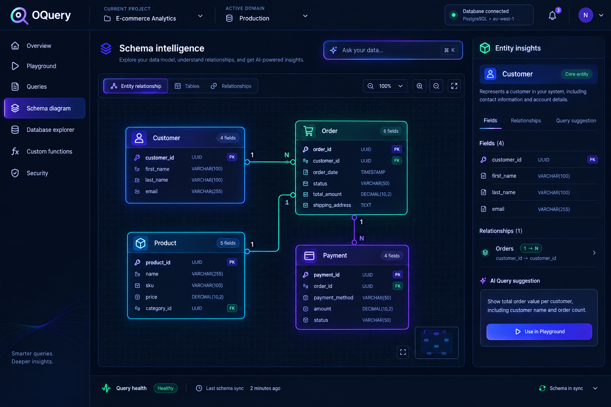
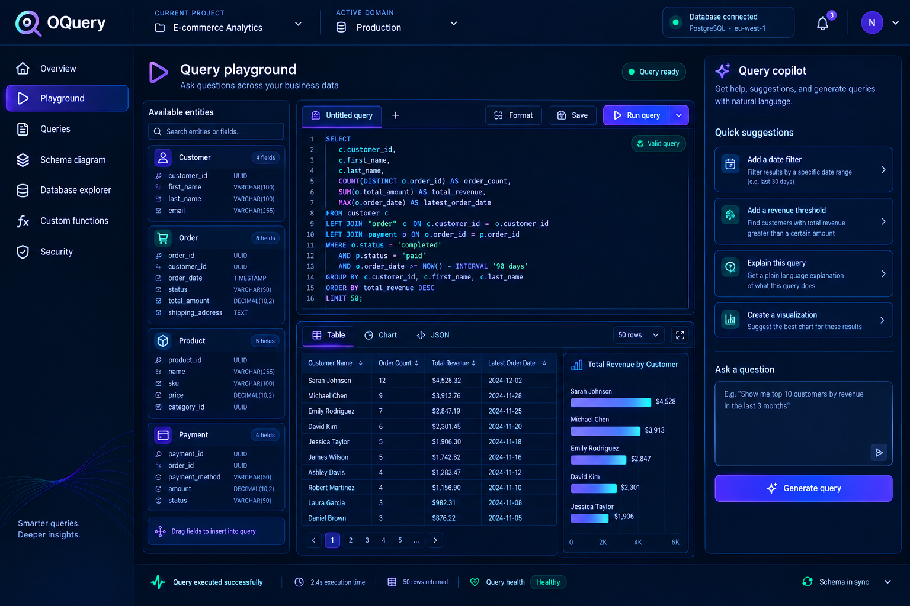
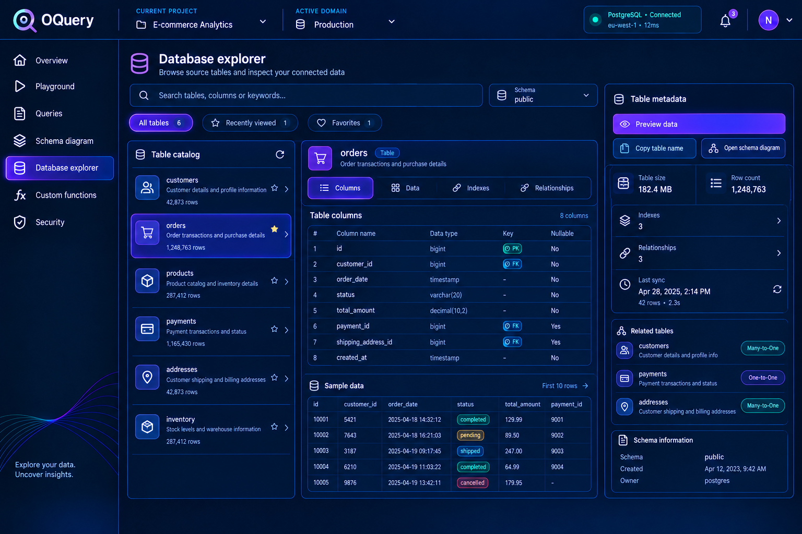
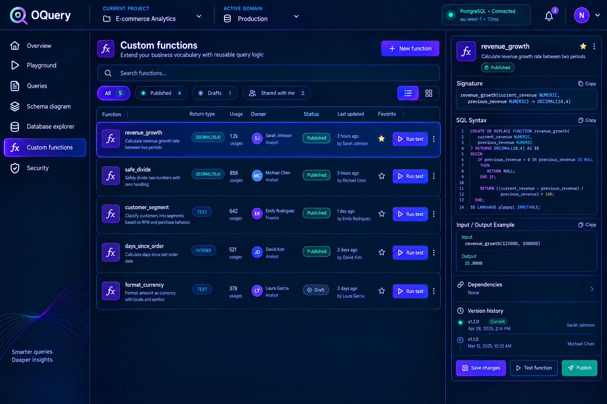

# OQuery UI prototypes

These screenshots are the visual reference for phase one of the OQuery UI redesign.
Phase one focuses on the static layout, CSS system, responsive behavior, and interaction states.
Data binding and API-backed behavior are intentionally deferred to phase two.

## Product shell

The schema intelligence view establishes the shared application shell: project and domain context,
database status, workspace navigation, entity visualization, and an inspector panel.

## Playground

The playground reference defines the query editor layout, entity/field palette, result tabs,
visualization area, and query copilot panel.

### Playground header redesign

- **Actions:** **Run** (primary, runs the entry context) and **Save** come first. **Reload**, **New**, and
  **Delete** (saved playgrounds only) follow, and **Format** is a placeholder that always stays in the `⋯` menu.
- **Layout:** the header row spans the full page width, above the editor and the AI assistant. The
  assistant starts below the header, and the action group sits at the far right.
- **Responsive actions:** the action group shows as many actions inline as the width allows, in the order
  above. The rest move into the `⋯` menu, which is listed below the inline actions.
- **Status:** an "Unsaved" label sits next to the actions while the playground has unsaved changes.
- **Explorer tabs:** Saved and Entities use an underline style, scoped to the explorer panel. The
  editor's document tabs are unchanged.
- **Styling constraint:** `.main-layout-heading` is shared by every page. Playground changes must not
  override it. Buttons keep the canonical `.button` styles.
- **Sections:** the Saved/Entities explorer, the editor, and the AI assistant each start with a 1px top border (`#252b38`).
- **Rename saved playground:** double-click the open saved item to edit its name inline. Enter or blur
  applies, Escape cancels, and an empty name keeps the old one. The new name stays in memory like any
  other edit (the item shows the unsaved marker) and is written only when Save is clicked. Non-open
  saved items are opened first, then renamed.
- **Results:** results stay inline under the context block that produced them. A separate results
  panel is out of scope, because inline results are the existing execution model.

## Shared page header

Every page header uses one component, `Heading` in [main-layout.tsx](/D:/SourceCode/Github/public/oquery-ui/src/OQuery.UI.Frontend/src/components/main-layout/main-layout.tsx). Its right-hand action group is data-driven (`actionItems`), so pages reuse the same layout and collapse behavior without copying markup.

- **Layout:** title on the left; a status label (for example "Unsaved") and the action group on the right.
- **Actions:** each action has a label, icon, handler, optional `disabled`, optional `title`, and a button `className`
  for its inline style. Button styles stay as they are today (`.button` on the Playground, `.domain-action-button` on the Domain Diagram).
- **Overflow:** an action marked `overflowOnly` always appears only in the `⋯` menu. Other actions appear inline
  in order while they fit; the rest move into the menu. The split is measured, so it updates on every resize.
- **Stacking:** the open menu raises its header above the AI assistant, using `:has()` on the menu panel.

Pages using it: the Playground (Run, Save; Reload, New, Delete, and a disabled Format in the menu) and the Domain Diagram
(Delete, Save, Reload, Edit, Create). The diagram no longer has a separate toolbar above the canvas.

## Saved queries

The saved queries reference defines search, filters, query cards, ownership metadata, activity,
and the selected-query details panel.

## Overview

The overview reference defines KPI cards, query activity, schema health, quick actions,
recent queries, and the activity timeline.

## Database explorer

The database explorer is the real `DataSources` component (table catalog, table details, and data preview), rendered
in `MainLayout` by `database-explorer-page.tsx` at `/database-explorer`. The former static mock in the playground
workspace was removed. The reference screenshot below is kept for layout comparison only.

The reference defines the table catalog, table structure and sample data, metadata, relationships, and schema actions.

## Custom functions

The custom functions reference defines the function library, status filters, syntax editor,
examples, dependencies, version history, and publishing actions.

## Security and access

The security reference defines policy metrics, policy management, protected-field configuration,
rule previews, access controls, and audit activity.

## Phase-one implementation notes

- The sidebar layout is applied to the real workspace routes through
  `src/OQuery.UI.Frontend/src/components/app-shell/app-shell.css`. Page content still renders the
  existing components until each page is bound to data in phase two.
- Keep the screenshots as visual references; do not treat their sample values as application data.
- Build shared shell primitives before page-specific panels: header, navigation, cards, badges,
  tabs, tables, inspector panels, and status indicators.
- Use static fixtures for layout previews only. Replace them with service state during phase two.
- Preserve accessible labels, keyboard focus states, and responsive behavior while matching the
  dark navy, violet, cyan, and mint visual language.
