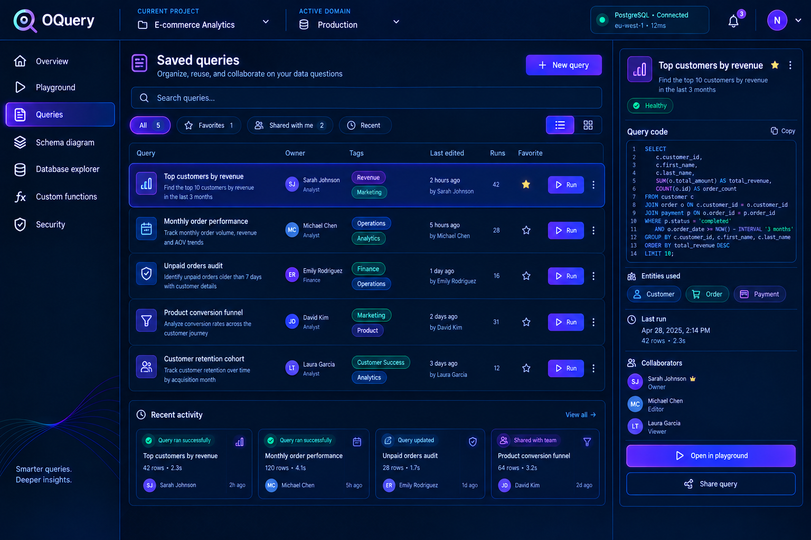
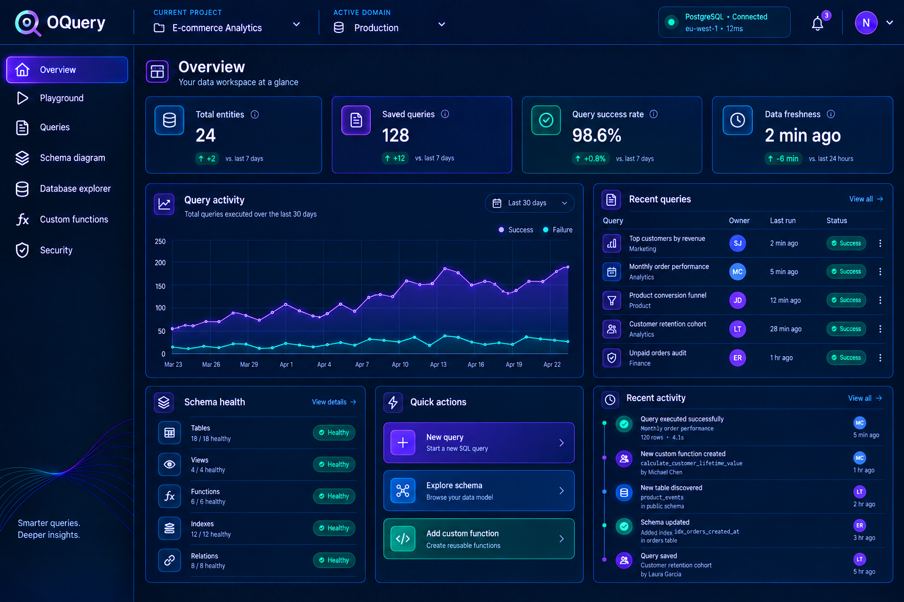
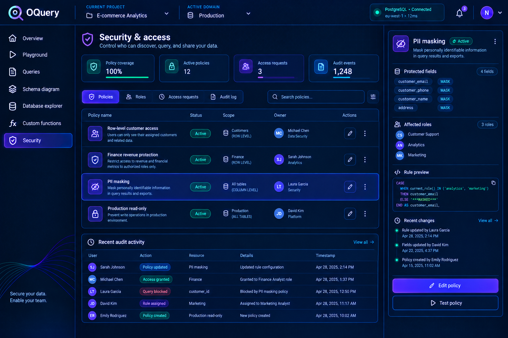

# OQuery UI prototypes

These screenshots are the visual reference for phase one of the OQuery UI redesign.
Phase one focuses on the static layout, CSS system, responsive behavior, and interaction states.
Data binding and API-backed behavior are intentionally deferred to phase two.

## Product shell

The schema intelligence view establishes the shared application shell: project and domain context,
database status, workspace navigation, entity visualization, and an inspector panel.

## Playground

The playground reference defines the query editor layout, entity/field palette, result tabs,
visualization area, and query copilot panel.

## Saved queries

The saved queries reference defines search, filters, query cards, ownership metadata, activity,
and the selected-query details panel.

## Overview

The overview reference defines KPI cards, query activity, schema health, quick actions,
recent queries, and the activity timeline.

## Database explorer

The database explorer reference defines the table catalog, table structure and sample data,
metadata, relationships, and schema actions.

## Custom functions

The custom functions reference defines the function library, status filters, syntax editor,
examples, dependencies, version history, and publishing actions.

## Security and access

The security reference defines policy metrics, policy management, protected-field configuration,
rule previews, access controls, and audit activity.

## Phase-one implementation notes

- The sidebar layout is applied to the real workspace routes through
  `src/OQuery.UI.Frontend/src/components/app-shell/app-shell.css`. Page content still renders the
  existing components until each page is bound to data in phase two.
- Keep the screenshots as visual references; do not treat their sample values as application data.
- Build shared shell primitives before page-specific panels: header, navigation, cards, badges,
  tabs, tables, inspector panels, and status indicators.
- Use static fixtures for layout previews only. Replace them with service state during phase two.
- Preserve accessible labels, keyboard focus states, and responsive behavior while matching the
  dark navy, violet, cyan, and mint visual language.
