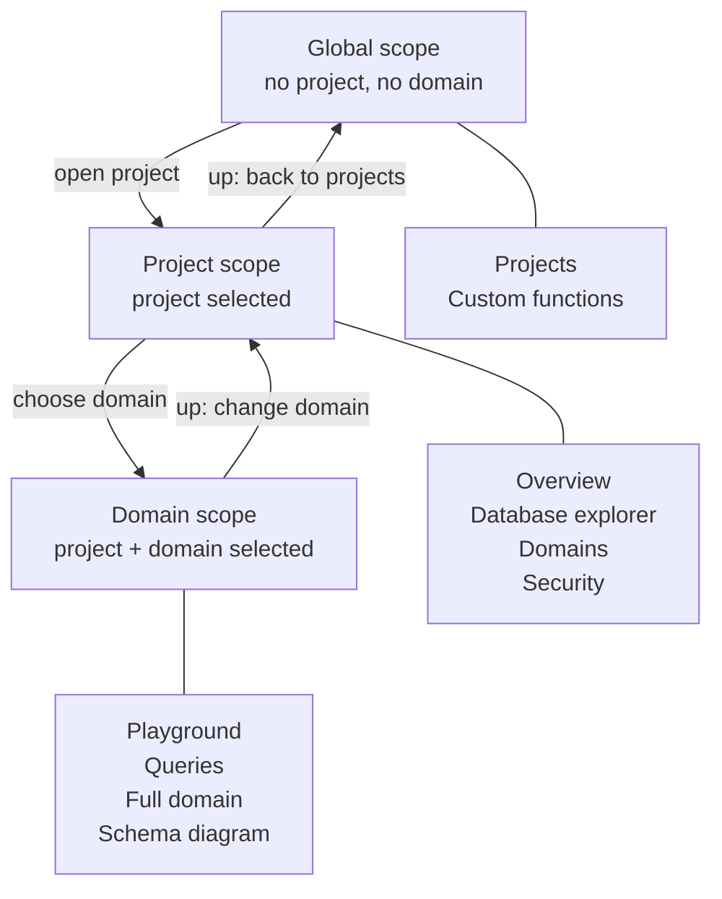

# Scope-aware navigation (design prototype)

Status: proposal, phase one (layout and navigation only). No behavior is changed by this document.

## Problem

The workspace menu currently requires a project and a domain for every item. This fits about 90% of
business flows (Playground, Queries, Full domain, Schema diagram), but it blocks features that
do not depend on a domain or do not depend on a project at all:

- **Database explorer** only needs a project (source tables belong to the project's database).
- **Custom functions** need neither a project nor a domain (business vocabulary is reusable).

## Proposal: three navigation scopes

Each menu item declares the minimum scope it needs. The sidebar shows only the items reachable from
the current scope, and the context switcher lets the user move up or down a scope level.

| Scope | Context required | Menu items |
| --- | --- | --- |
| **Global** | none | Projects, Custom functions |
| **Project** | project | Overview, Database explorer, Domains (picker), Security |
| **Domain** | project + domain | Playground, Queries, Full domain, Schema diagram |

Notes:

- Security placement is an assumption. It is listed under Project scope; move it to Domain scope if
  policies are per domain.
- Custom functions move out of the project-bound EXTEND group into Global scope.
- The Domain scope is the only one that needs a domain selector. Entering it from Project scope
  either uses the last-selected domain or opens the domain picker.

## Scope model



## Sidebar wireframe

```text
+------------------------------+
| [Context]  Global            |   <- breadcrumb / scope switcher
|------------------------------|
| GLOBAL                       |
|   Projects                   |
|   Custom functions           |
|------------------------------|
| PROJECT  (Northstar Demo)    |   <- shown when a project is selected
|   Overview                   |
|   Database explorer          |
|   Domains                    |
|   Security                   |
|------------------------------|
| DOMAIN  (Sales)              |   <- shown when a domain is selected
|   Playground                 |
|   Queries                    |
|   Full domain                |
|   Schema diagram             |
+------------------------------+
```

Rules:

1. Groups are rendered only when their scope is satisfied. Global items always render.
2. Selecting a project keeps Global items visible, so Custom functions is always one click away.
3. Domain items are hidden (not disabled) at Project scope, so the menu never shows dead links.
4. The breadcrumb shows the active scope; each segment is clickable to move up one level.

## Route mapping

| Route | Scope | Current behavior | Change |
| --- | --- | --- | --- |
| Projects list | Global | Exists | Show as Global entry point |
| `functions` (Custom functions) | Global | Under EXTEND, uses `PAGE_PATHS.functions` | Available without project; no `withProject` wrapper |
| Database explorer (`DATABASE_EXPLORER_PATH`) | Project | Wrapped with `withProject(...)` | Keep project param; drop domain requirement |
| Overview (`DOMAINS_PATH` with project) | Project | Wrapped with `withProject(...)` | Unchanged |
| Playground / Queries (`builderLink`) | Domain | Needs project and domain | Unchanged; hidden below Domain scope |
| Full domain / Schema diagram | Domain | Needs project and domain | Unchanged; hidden below Domain scope |

## Algorithm

Scope resolution is a pure function of the URL and selection state. It is cheap (constant work over
about 10 items) and runs on each render, so no caching is needed.

```text
resolveScope(projectId, domainId):
    if projectId is empty           -> GLOBAL
    if domainId is empty            -> PROJECT
    otherwise                       -> DOMAIN

visibleGroups(scope):
    groups = [GLOBAL_GROUP]
    if scope >= PROJECT: groups += PROJECT_GROUP
    if scope >= DOMAIN:  groups += DOMAIN_GROUP
    return groups
```

Each menu item is declared once with `minScope` instead of inline `withProject(...)` calls. This makes
it hard to add a feature that silently requires a domain, and keeps the security-sensitive checks in
the existing backend path (no new authorization logic is introduced by this navigation change).

## Implementation plan (phase two, after approval)

1. Replace the inline `items` array in the workspace navigation with declared groups carrying `minScope`.
2. Derive the visible groups with `resolveScope(projectId, domainId)`.
3. Add the breadcrumb scope switcher to the sidebar header.
4. Move Custom functions out of the project-bound route wrapper.
5. Update `docs/frontend/studio-guide.md` and `docs/design/oquery-ui-prototypes.md` to match.

Validation: `npx vite build` and `npx vitest run` in `src/OQuery.UI.Frontend`, plus a manual check of
the three scopes (no project, project only, project and domain).

## Open questions

- Should Security be Project scope or Domain scope?
- When a project has no domains, should the Domain group be hidden or show an empty-state hint?
- Should Custom functions remain global, or be scoped per project with a global library?
