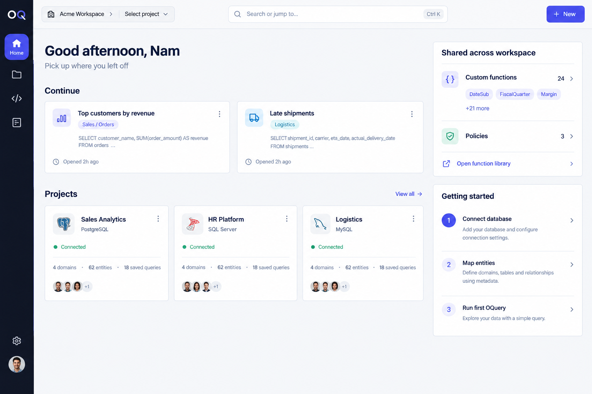
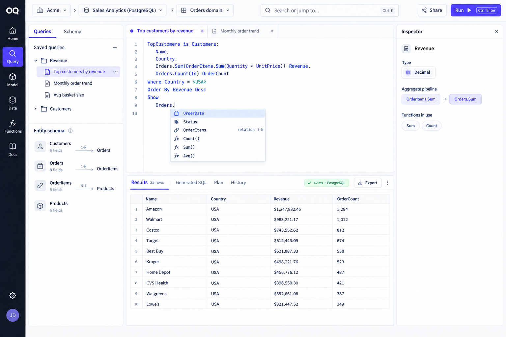
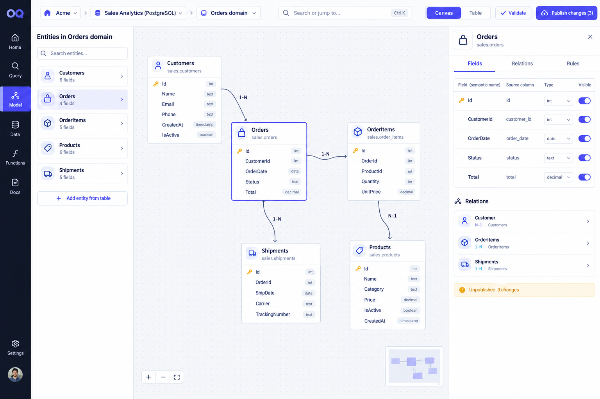
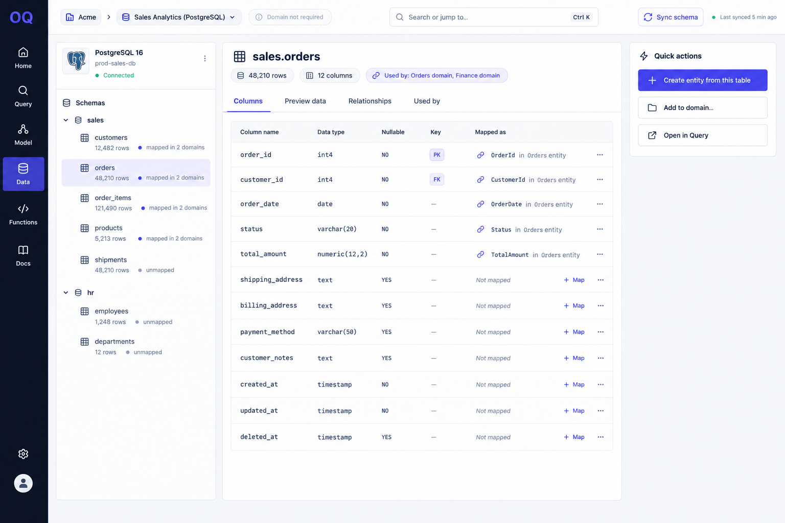
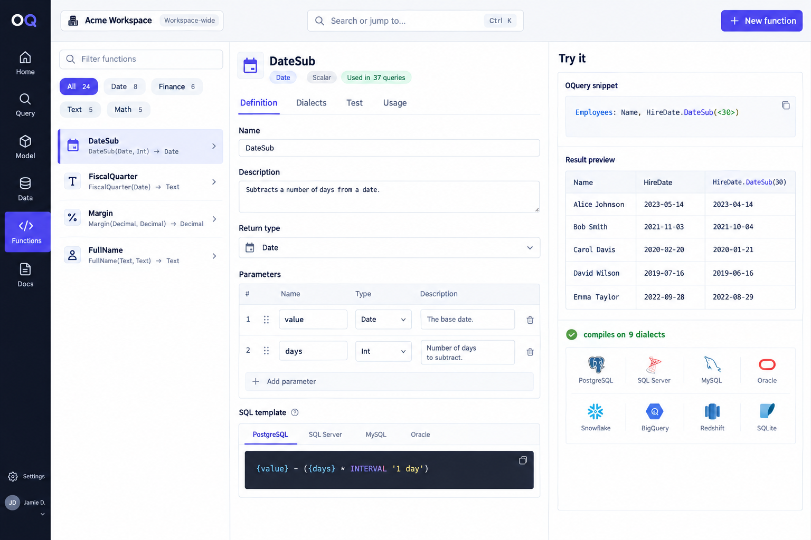
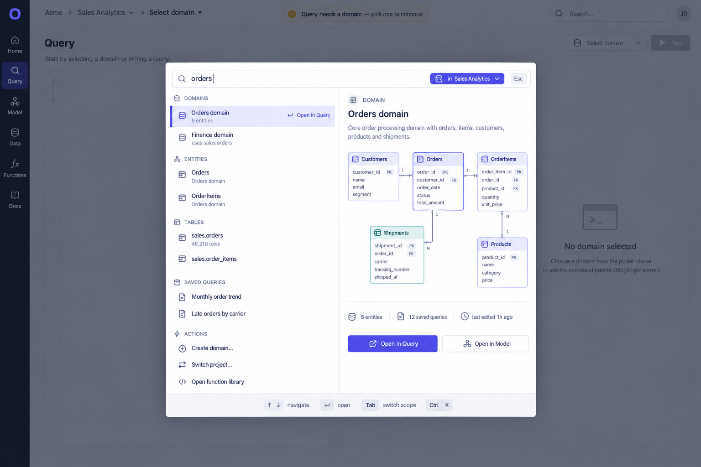

# OQuery Studio — UI/UX redesign proposal

Status: **Proposal / prototype**. This is a clean-sheet design. It is based on the current
feature set, not on the current layout.

## 1. Problem with the current shell

- The shell asks for a **Project + Domain** before most pages render. That works for
  Playground and modeling, but not for features that need less context:
  - **Database explorer** needs only a project (connection).
  - **Custom functions** and **Security policies** are workspace-wide.
- Navigation is grouped by internal concepts ("BUILD", "DOMAIN STUDIO", "EXTEND"), and
  "Overview", "Playground", and "Queries" point to the same places.
- Users must go to a separate page to change context. There is no fast way to jump
  between things.

## 2. Core idea: scope-aware shell

Every feature declares the **scope it needs**. The shell asks only for that scope.

| Area (rail) | Required scope | What lives here |
|---|---|---|
| **Home** | Workspace | Recent work, projects, onboarding, shared assets |
| **Query** | Project + Domain | OQuery editor, saved queries, results, generated SQL, plan, history |
| **Model** | Project + Domain | Entities, relations, diagram (Canvas) and table (Table) views, publish |
| **Data** | Project | Connection, schemas, tables, columns, preview, "mapped in N domains" |
| **Functions** | Workspace | Custom function library, dialect templates, test, usage |
| **Docs** | none | OQuery syntax and guides |
| Settings (bottom) | Workspace / Project | Security policies, query limits, audit log, admin analytics |

Rules:

1. **The breadcrumb is the scope switcher.** `Workspace › Project ▾ › Domain ▾`. Only the
   levels the current area needs are shown. Levels that are not needed are hidden or shown
   as a muted chip ("Domain not required").
2. **Never block with a full-page gate.** If an area needs a missing scope, it shows an
   inline empty state and a hint ("Query needs a domain — pick one to continue"). The
   palette opens with that level already selected.
3. **Scope is remembered per area.** Changing the project resets the domain only if the
   domain does not belong to the new project.
4. **URLs mirror the scope.** Each area uses only the segments it needs:
   - `/` (Home), `/functions/:functionId?` (workspace)
   - `/p/:projectId/data/:schema?/:table?` (project)
   - `/p/:projectId/d/:domainId/query/:queryId?` and `/p/:projectId/d/:domainId/model` (domain)

## 3. Layout system

- **Icon rail (56px, dark).** It lists the six areas from section 2. It never changes with
  scope, so it is always easy to find.
- **Top bar.** Scope breadcrumb on the left, global search / command palette (`Ctrl K`) in
  the center, and the main action for the area on the right (Run, Publish, New function,
  Sync schema).
- **Work area = explorer | canvas | inspector.** The left explorer and right inspector can
  be collapsed. The bottom dock (results, SQL, plan, history) can be resized.
- **Visual language.** Light neutral canvas `#F7F8FA`, white surfaces, 1px `#E6E8EC`
  borders, indigo accent `#4F46E5`, Inter for UI and JetBrains Mono for code and data, and
  an 8px radius.

## 4. Screens

### 4.1 Home — workspace scope

"Continue" cards for recent queries, project cards with connection health and counts,
shared workspace assets (functions, policies), and a getting-started checklist.

### 4.2 Query Studio — project + domain scope

The left panel has two tabs, Queries and Schema. The editor has multiple tabs and supports
dot-context completion. The bottom dock shows Results, Generated SQL, Plan, and History. The
inspector shows the type, the aggregate pipeline, and the functions used by the selected
field.

### 4.3 Model designer — project + domain scope

You can switch between Canvas and Table views. The entity list is limited to the current
domain. The inspector has Fields, Relations, and Rules tabs. A draft or publish flow with
the "Publish changes (N)" button replaces silent saves.

### 4.4 Data explorer — project scope only

No domain is needed. The page shows the connection status and a schema/table tree with
"mapped in N domains" markers. Each column shows how it is mapped, with a "+ Map" action
when it is not mapped. Quick actions: create an entity, add to a domain, or open in Query.

### 4.5 Function library — workspace scope

No project or domain is needed. You can filter by category, edit the signature, and edit
SQL templates for each dialect. A live "Try it" panel shows a result preview and dialect
compile status.

### 4.6 Command palette and scope switching

One search covers domains, entities, tables, saved queries, and actions. A scope chip
(`Tab` to switch) limits the results. A preview pane shows the selected item. This replaces
the forced selection gate.

## 5. Mapping from the current app

| Current | New |
|---|---|
| Workspace gate (Project + Domain required) | Scope breadcrumb + inline empty states |
| Overview / Playground / Queries | **Home** (overview) and **Query** (playground + saved queries) |
| Full domain / Schema diagram | **Model** (Canvas and Table views) |
| Database explorer / Data sources | **Data** (project scope) |
| Custom functions | **Functions** (workspace scope) |
| Security | **Settings › Security** (policies, limits, audit) |
| Admin analytics | **Settings › Admin** (admins only) |

## 6. Implementation notes (for later)

- Add one `requiredScope: "none" | "workspace" | "project" | "domain"` to each route
  definition. The shell builds the breadcrumb and the empty states from it. This replaces
  the special cases in `main.tsx` (`playgroundRouteOf`, the workspace gate).
- Keep the old URLs working with redirects (`/playground/:p/:d/:q` → `/p/:p/d/:d/query/:q`).
- The command palette reads the existing project, domain, entity, table, and query APIs. No
  new backend is needed for v1.
